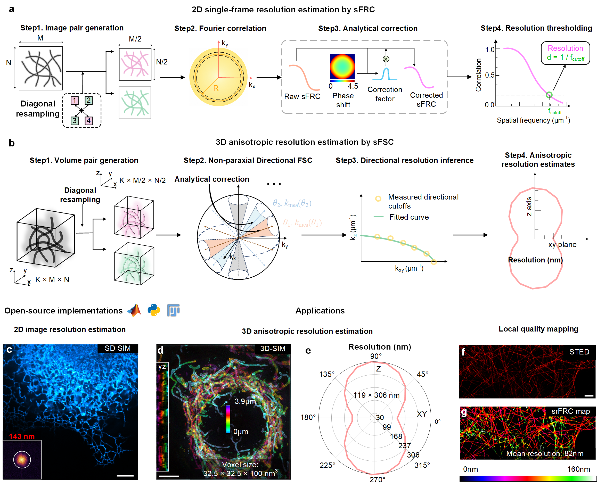

# srFRCj

Fiji/ImageJ implementation of the single-acquisition sFRC/sFSC resolution-estimation framework.

**Note: this repository is still in heavy development.** If you encounter any issues or unexpected behavior, please [file an issue](https://github.com/SR-Wiki/srFRCj/issues).

## Publication

This repository accompanies the manuscript:

> **Single-acquisition estimation of anisotropic 3D resolution in super-resolution fluorescence microscopy**

Final bibliographic information and DOI will be added after publication.


**Other implementations:** [MATLAB / srFRCm](https://github.com/SR-Wiki/srFRCm) · [Python / srFRCpy](https://github.com/SR-Wiki/srFRCpy)

[Introduction](#introduction) · [Installation](#installation) · [Demo data](#demo-data) · [Basic parameters](#basic-parameters) · [Version](#version) · [Resources](#resources) · [License](#license)


## Introduction

Effective resolution in fluorescence microscopy depends on the sample, fluorophores, acquisition conditions and reconstruction procedure, creating a need for direct resolution assessment from acquired data. Fourier ring correlation (FRC) and Fourier shell correlation (FSC) provide image-based resolution estimates from the highest spatial frequencies shared by two observations, but repeated fluorescence acquisitions can be compromised by sample dynamics, photobleaching, drift and acquisition variability.

Three-dimensional fluorescence imaging presents an additional challenge because optical resolution is anisotropic, voxel spacings and array dimensions commonly differ across axes, and sequential z-stack acquisition can introduce inter-slice inconsistencies. These effects make direct axial-resolution estimation particularly sensitive to paraxial Fourier artifacts and acquisition-dependent changes.

The framework addresses these problems with **single-frame FRC (sFRC)** and **single-volume FSC (sFSC)**. sFRC generates two complementary observations from one 2D image by exploiting local spatial redundancy and point-spread-function symmetry, followed by an analytical frequency-domain correction for the deterministic bias introduced by diagonal resampling. sFSC extends the same single-acquisition principle to 3D volumes and introduces **directional resolution inference (DRI)**, which estimates axial resolution from reliable non-paraxial directional FSC information while accommodating anisotropic resolution and unequal sampling. The framework is further extended to spatially resolved analysis through **srFRC**.

<p align="center">

</p>


## Installation

### Tested platform
  - Windows 10, ImageJ 1.54p with Java 21.0.7 (64-bit).

### Dependencies
srFRCJ uses ND4J, JavaCPP and OpenBLAS. The native runtime must match the operating system and CPU architecture.

### Prebuilt plugin

Download the build matching your platform using the direct links below:

| Platform | Plugin | Runtime dependencies |
| --- | --- | --- |
| Windows x86_64 | [Plugin JAR](https://github.com/SR-Wiki/srFRCj/raw/refs/heads/main/target/fiji-windows-x86_64/plugins/srFRCJ_-0.1.11.jar) | [jars.zip](https://github.com/SR-Wiki/srFRCj/raw/refs/heads/main/target/fiji-windows-x86_64/jars.zip) |
| Linux x86_64 | [Plugin JAR](https://github.com/SR-Wiki/srFRCj/raw/refs/heads/main/target/fiji-linux-x86_64/plugins/srFRCJ_-0.1.11.jar) | [jars.zip](https://github.com/SR-Wiki/srFRCj/raw/refs/heads/main/target/fiji-linux-x86_64/jars.zip) |
| macOS Apple Silicon / ARM64 | [Plugin JAR](https://github.com/SR-Wiki/srFRCj/raw/refs/heads/main/target/fiji-macosx-arm64/plugins/srFRCJ_-0.1.11.jar) | [jars.zip](https://github.com/SR-Wiki/srFRCj/raw/refs/heads/main/target/fiji-macosx-arm64/jars.zip) |

> The Windows/Linux builds target the Java 8 workflow. The native Apple-Silicon build uses a newer ARM64 runtime stack and requires Java 11 or newer.

### Install into Fiji

1. Close Fiji.
2. Copy the downloaded plugin JAR into:

   ```text
   Fiji.app/plugins/
   ```

3. Open:

   ```text
   Fiji.app/jars/
   ```

4. Remove the existing incompatible `javacpp-*.jar`, `nd4j-*` or `openblas-*` files. You may backup them for possible later use. 
5. Extract the platform runtime ZIP and copy all JARs from its `jars/` folder into:

   ```text
   Fiji.app/jars/
   ```

6. Restart Fiji.

Do not mix native JARs from different platforms.

### Platform runtime stacks

| Platform | Java | ND4J | JavaCPP | OpenBLAS |
| --- | --- | --- | --- | --- |
| Windows x86_64 | Java 8+ | `1.0.0-beta7` | `1.5.3` | `0.3.9-1-1.5.3` |
| Linux x86_64 | Java 8+ | `1.0.0-beta7` | `1.5.3` | `0.3.9-1-1.5.3` |
| macOS ARM64 | Java 11+ | `1.0.0-M2.1` | `1.5.7` | `0.3.19-1.5.7` |

### Build from source with Maven (optional)
If you prefer to compile srFRCJ rather than download the prebuilt plugin, clone the source repository and run the platform-specific Maven build. This is an **alternative installation option**.

From the Maven project root:

```bash
# Windows x86_64
mvn -f pom-windows.xml clean package

# Linux x86_64
mvn -f pom-linux.xml clean package

# macOS Apple Silicon / ARM64
mvn -f pom-macos.xml clean package
```

The corresponding build produces the plugin JAR and the Fiji-ready runtime directory:

```text
target/srFRCJ_-0.1.11.jar

target/fiji-windows-x86_64/jars/
target/fiji-linux-x86_64/jars/
target/fiji-macosx-arm64/jars/
```

For release packaging, the platform-specific plugin JAR can be renamed to the matching release asset name shown above.

## Demo data

Download the shared Fiji example data:

[**Download example_data.zip**](https://github.com/SR-Wiki/srFRCj/releases/download/v1.0/example_data.zip)

Extract it into the cloned repository root:

```text
srFRCj/
├── docs/
├── img/
├── example_data/
└── ...
```
For screenshots, a function-by-function walkthrough, parameter explanations, and result interpretation, see **[Plugin features and usage (illustrated guide)](docs/pluginFeatures.md)**.

<!--
Planned examples:

<p align="center"></p>
<p align="center"></p>
<p align="center"></p>
-->
## Basic parameters

The Fiji plugin exposes a separate first-step dialog for each analysis mode. The routine parameters are therefore listed separately below. Advanced controls are documented in [**docs/advancedParameters.md**](docs/advancedParameters.md).

### sFRC

| Parameter | Default / source | Description |
| --- | --- | --- |
| Pixel Size | Image properties or user input | Physical lateral sampling in nm |
| If SingleFrame | `true` | Generates the complementary pair from one acquisition |

### sFSC

| Parameter | Default / source | Description |
| --- | --- | --- |
| Pixel Size (XY) | Image properties or user input | Physical lateral voxel spacing in nm |
| Pixel Size (Z) | Image properties or user input | Physical axial voxel spacing in nm |
| If SingleFrame | `true` | Enables single-volume pair generation |

### srFRC

| Parameter | Default / source | Description |
| --- | --- | --- |
| Block Size | `64` pixels | Local rolling-analysis window |
| Skip | `2` pixels | Step between neighboring rolling windows |
| Pixel Size | image calibration or user input | Physical lateral sampling in nm |
| If SingleFrame | `true` | Uses single-frame pair generation for local analysis |

Advanced controls for **sFRC**, **sFSC/DRI**, and **srFRC** are documented separately in [docs/advancedParameters.md](docs/advancedParameters.md).

> **Reference implementation:** For computational efficiency and numerical accuracy, the [MATLAB implementation (srFRCm)](https://github.com/SR-Wiki/srFRCm) is the reference. When comparing implementations or investigating discrepancies, use MATLAB results and execution times as the baseline. Python and Java may differ in numerical output and runtime performance.

## Version

**v0.1.11**

## Resources

- [Advanced parameters](docs/advancedParameters.md)
- [MATLAB implementation — srFRCm](https://github.com/SR-Wiki/srFRCm)
- [Python implementation — srFRCpy](https://github.com/SR-Wiki/srFRCpy)
- [srFRCJ Wiki](https://github.com/SR-Wiki/srFRCj/wiki/)
- [Related rolling-FRC publication](https://doi.org/10.1038/s41377-023-01321-0)

## Open source [srFRC](https://github.com/SR-Wiki/srFRCj)
This software and corresponding methods can only be used for **non-commercial** use, and they are under Open Data Commons Open Database License v1.0.
