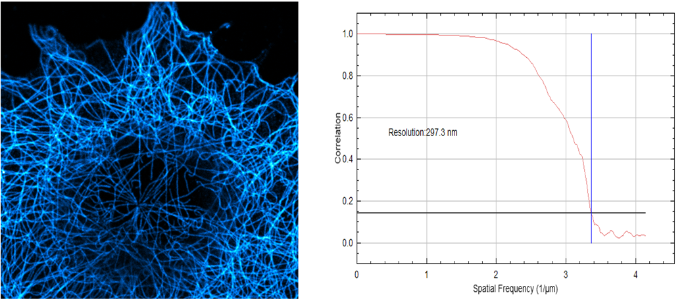
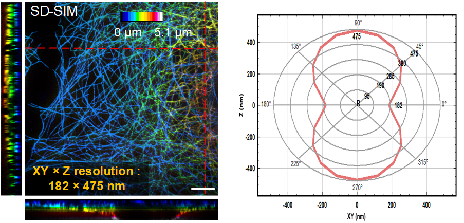
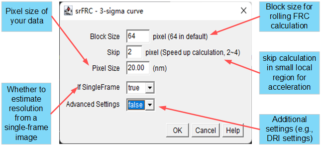
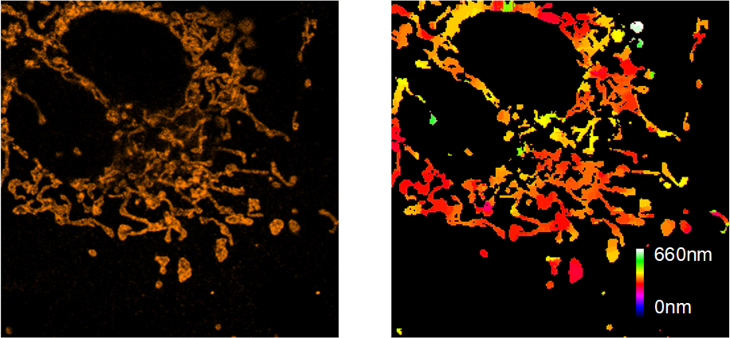

# Plugin features & basic usage — srFRCJ (Fiji/ImageJ)

This page covers the **first settings dialog** for the three main srFRCJ plugins. It follows the parameter labels and defaults in the Java plugin implementation. For installation, refer to the [main README](../README.md#installation).

Open the input image or stack in Fiji, then choose the appropriate tool from **Plugins → srFRC**. Enter pixel and voxel sizes in **nanometres (nm)**; for example, a 60 nm pixel size is entered as `60`.

## sFRC — global 2D resolution

**Menu:** `Plugins → srFRC → sFRC`

sFRC estimates the global lateral resolution from a single image or a pair of acquired frames and can display the correlation curve.

| Basic dialog field | Default / choices | Purpose |
| --- | --- | --- |
| **Pixel Size** | Image calibration or manually entered value (**nm**) | Lateral pixel spacing of the original image. |
| **If SingleFrame** | `true` (`true` / `false`) | `true`: construct complementary observations from one image; `false`: analyze adjacent acquired frames. |
| **Threshold** | `1/7 hard threshold` (`1/7 hard threshold` / `3-sigma`) | Choose the correlation cutoff used to estimate resolution. |
| **Plot** | `auto` (`auto` / `true` / `false`) | `auto`: preview the current frame's FRC curve; `true`: the same current-frame preview; `false`: suppress curve display. In paired mode, the preview uses the current frame and the following frame. Plotting does not determine whether other frames are computed. |
| **Advanced Settings** | `false` (`true` / `false`) | Leave `false` for the basic workflow; `true` opens a separate settings dialog. |

**Basic workflow:** Open the input 2D image or multi-frame stack, enter its actual pixel size, choose single-frame or paired-frame analysis, select a threshold, and leave **Plot = auto** to view the FRC curve. Read the estimated resolution (nm) alongside the selected cutoff.

## sFSC — lateral and axial 3D resolution

For very large 3D stacks, sFSC may cancel before computation and ask you to crop the input; see [Advanced Parameters](advancedParameters.md#large-3d-input-memory-protection).

**Menu:** `Plugins → srFRC → sFSC`

sFSC estimates lateral and axial resolution separately from a 3D stack.

| Basic dialog field | Default / choices | Purpose |
| --- | --- | --- |
| **If SingleFrame** | `true` (`true` / `false`) | `true`: use a single acquired 3D volume; `false`: analyze a pair of acquired volumes. |
| **3D Stack 1 (paired mode)** | Current open image | Choose Volume A from open 3D stacks. Disabled and ignored in single-frame mode. |
| **3D Stack 2 (paired mode)** | Another open image, when present | Choose Volume B (same XY/Z dimensions). Disabled and ignored in single-frame mode. |
| **Pixel Size (XY)** | Image calibration or manually entered value (**nm**) | Lateral voxel spacing. |
| **Pixel Size (Z)** | Image calibration or manually entered value (**nm**) | Spacing between successive z-planes. |
| **Threshold** | `1/7 hard threshold` (`1/7 hard threshold` / `3-sigma`) | Choose the FSC/FRC correlation cutoff. |
| **Advanced Settings** | `false` (`true` / `false`) | Leave `false` for the basic workflow; `true` opens a separate settings dialog. |

**Basic workflow:** For single-frame mode, activate one 3D volume and leave `If SingleFrame=true`; the two paired selectors have no effect. For paired mode, open both `Volume_A.tif` and `Volume_B.tif` in Fiji, set `If SingleFrame=false`, and select each file in the two `3D Stack` menus. Both inputs must be single-channel Z stacks with matching dimensions and one time point. The same two-channel hyperstack may also be selected twice to use channels 1 and 2 (legacy workflow). Enter the actual **XY** and **Z** voxel sizes in nm, select a threshold, and run. Interpret lateral and axial resolutions separately.

**Note:** Unlike sFRC and srFRC, the basic sFSC dialog does **not** include a `Plot` field. Its `Plot Fitting Curve` option is available only in the separate advanced settings dialog.

## srFRC — local 2D resolution mapping

**Menu:** `Plugins → srFRC → srFRC - resolution mapping`

srFRC calculates a spatial map of local resolution by applying FRC to overlapping image regions.

| Basic dialog field | Default / choices | Purpose |
| --- | --- | --- |
| **Block Size** | `64` pixels | Side length of each local analysis window. |
| **Skip** | `2` pixels | Step between successive local window positions. |
| **Pixel Size** | Image calibration or manually entered value (**nm**) | Lateral pixel spacing of the input image. |
| **If SingleFrame** | `true` (`true` / `false`) | `true`: use complementary observations derived from one image; `false`: analyze two acquired frames. |
| **Threshold** | `3-sigma` (`1/7 hard threshold` / `3-sigma`) | Choose the local correlation cutoff. |
| **Plot** | `auto` (`auto` / `true` / `false`) | `auto`: show the current frame's resolution map; `true`: the same current-frame preview; `false`: hide the map preview. In paired mode, the preview corresponds to the current frame and the next frame. Computation of other frames is independent of the preview. |
| **Advanced Settings** | `false` (`true` / `false`) | Leave `false` for the basic workflow; `true` opens a separate settings dialog. |

**Basic workflow:** Open a 2D image or multi-frame stack, set **Block Size**, **Skip**, and **Pixel Size**, choose the frame mode and threshold, and leave **Plot = auto** to inspect the local resolution map. Smaller *valid* resolution values indicate finer local detail; excluded background regions should not be interpreted as valid measurements.

---

For additional controls and diagnostics, see **[Advanced Parameters](advancedParameters.md)**.
