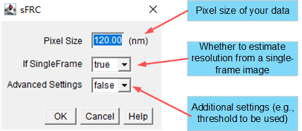
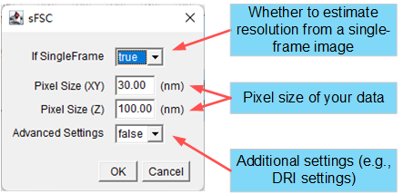

# Plugin features & basic usage — srFRCJ (Fiji/ImageJ)

This page introduces the **basic settings dialogs** and typical outputs of the three srFRCJ plugins. Optional controls are documented in [Advanced Parameters](advancedParameters.md). For installation, see the [main README](../README.md#installation).

Open an image or stack in Fiji and select a tool under **Plugins → srFRC**. All pixel and voxel spacings are entered in **nanometres (nm)** (for example, enter `60` for 60 nm). When available, Fiji **Image > Properties** supplies initial values for the Pixel Size fields; **values entered in the plugin dialog take precedence** and are used for calculation.

## sFRC — global 2D resolution

**Menu:** `Plugins → srFRC → sFRC`

sFRC estimates global lateral resolution from one 2D image or two adjacent acquired frames. In single-frame mode, it generates complementary observations from the input image. The correlation curve for the current frame/pair is displayed automatically.

| Basic dialog field | Default / choices | Purpose |
| --- | --- | --- |
| **Pixel Size** | Image properties or user input (**nm**) | Lateral pixel spacing of the original image. |
| **If SingleFrame** | `true` (`true` / `false`) | `true`: generate complementary observations from one image; `false`: analyze adjacent acquired frames. |
| **Threshold** | `1/7 hard threshold` (`1/7 hard threshold` / `3-sigma`) | Correlation cutoff used to estimate resolution. |
| **Advanced Settings** | `false` (`true` / `false`) | Open a separate dialog for optional controls. |

**Basic workflow:** Open a 2D image or multi-frame stack, confirm the actual **Pixel Size**, select single-frame or paired-frame analysis and the correlation threshold, then run. Read the estimated resolution in **nm** in the results and inspect the automatically displayed current-frame FRC curve. **There is no `Plot` control in the basic dialog.**

**Stack behavior:** In advanced settings, **Stack Batch Processing** is enabled by default. With Batch ON, all frames (single-frame mode) or adjacent frame pairs (paired mode) are analyzed, but only the current frame/pair's correlation curve is displayed. With Batch OFF, only the currently selected frame/pair is analyzed. Other advanced options include **Apply Correction** (default `true`) and **Show Resampled images** (default `false`).

## sFSC — lateral and axial 3D resolution

For very large 3D stacks, sFSC may stop before computation and request a smaller input; see [Advanced Parameters — sFSC](advancedParameters.md#sfsc).

**Menu:** `Plugins → srFRC → sFSC`

sFSC estimates lateral (**XY**) and axial (**Z**) resolution from a 3D volume or a pair of acquired volumes. **Directional resolution inference (DRI)** uses directional correlation cutoffs to infer axial resolution.

| Basic dialog field | Default / choices | Purpose |
| --- | --- | --- |
| **If SingleFrame** | `true` (`true` / `false`) | `true`: generate a complementary pair from one 3D volume; `false`: analyze two acquired volumes. |
| **3D Stack 1 (paired mode)** | Current open image | Select the first volume; disabled and ignored in single-frame mode. |
| **3D Stack 2 (paired mode)** | Another open image, when available | Select the second volume; disabled and ignored in single-frame mode. |
| **Pixel Size (XY)** | Image properties or user input (**nm**) | Lateral voxel spacing. |
| **Pixel Size (Z)** | Image properties or user input (**nm**) | Axial spacing between successive z-planes. |
| **Threshold** | `1/7 hard threshold` (`1/7 hard threshold` / `3-sigma`) | Correlation cutoff used for the FSC/FRC analysis. |
| **Advanced Settings** | `false` (`true` / `false`) | Open a separate dialog for optional controls. |

**Basic workflow:** For single-frame mode, activate a 3D volume and leave **If SingleFrame = true**; the two stack selectors are inactive. For paired mode, open both volumes, set **If SingleFrame = false**, and select each in the corresponding `3D Stack` field. Two separate volumes must be single-channel Z stacks with matching XY dimensions and Z slice counts, and one time point each. For the legacy two-channel workflow, the same two-channel 3D hyperstack can be selected in both fields. Confirm the actual **XY** and **Z** voxel spacings and run. Interpret the XY and Z resolution estimates separately.

**Advanced plotting and sampling:** None of the three basic dialogs has a `Plot` field. The sFSC advanced dialog retains **Plot Fitting Curve** (default `false`) for the optional DRI fitting plot. **Z Sampling** is also optional and **OFF by default**; it is not enabled automatically. If Z Sampling is disabled in single-frame mode and a finite axial estimate is obtained, the program may display an informational note. This note does not mean the program has detected an overoptimistic result.

**Result interpretation:** The displayed directional profile and reported **E_DRI** describe the DRI fit. E_DRI is a directional fitting-consistency metric, **not** an error measured against ground truth. See [Advanced Parameters](advancedParameters.md#sfsc) for fitting-angle recommendations and detailed interpretation.

## srFRC — local 2D resolution mapping

**Menu:** `Plugins → srFRC → srFRC - resolution mapping`

srFRC estimates spatially varying resolution by applying FRC to overlapping regions of a 2D image or image stack.

| Basic dialog field | Default / choices | Purpose |
| --- | --- | --- |
| **Block Size** | `64` pixels | Side length of the local analysis window. |
| **Skip** | `2` pixels | Step between successive window positions. |
| **Pixel Size** | Image properties or user input (**nm**) | Lateral spacing of the original image. |
| **If SingleFrame** | `true` (`true` / `false`) | `true`: generate complementary observations from each image; `false`: analyze adjacent acquired frames. |
| **Threshold** | `3-sigma` (`1/7 hard threshold` / `3-sigma`) | Local correlation cutoff. |
| **Advanced Settings** | `false` (`true` / `false`) | Open a separate dialog for optional controls. |

**Basic workflow:** Open a 2D image or stack, confirm **Block Size**, **Skip**, and **Pixel Size**, select the frame mode and threshold, then run. The resolution map is displayed automatically; **there is no `Plot` control in the basic dialog**. Smaller **valid** resolution values indicate finer local detail. A map value of **0** denotes background or an unavailable estimate, **not** a resolution of 0 nm.

**Stack and colorbar behavior:** **Stack Batch Processing** is ON by default. When Batch is ON and **Monitor Changes** is OFF, srFRC displays a **Float32 quantitative resolution-map stack** and an **RGB preview stack with a separate colorbar for each frame**. Color scaling is frame-specific, so the same color in different frames need not represent the same resolution. Use the Float32 stack—not the RGB display—for quantitative measurements. With Batch OFF, only the current frame/pair is analyzed and displayed.

**Background options:** Automatic background estimation is enabled by default. In advanced settings, **Monitor Changes** compares several background settings for the current frame/pair and automatically disables Batch Processing. When both automatic background estimation and monitoring are disabled, **Background Intensity** provides a manual threshold. Background intensity thresholds are distinct from the selected FRC correlation threshold.

---

For additional controls, diagnostic messages and result interpretation, see **[Advanced Parameters](advancedParameters.md)**.
